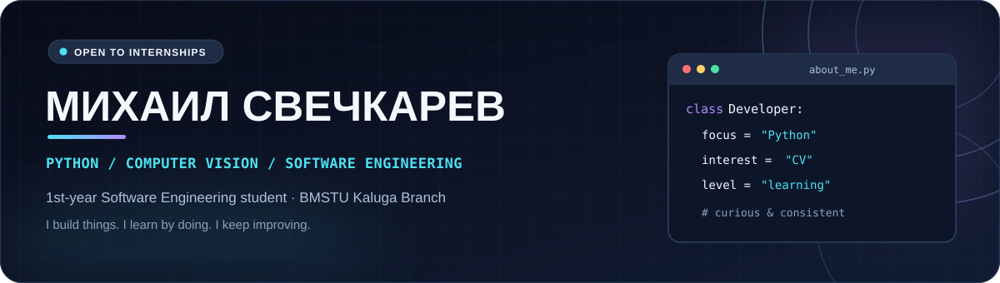

<!-- ╔════════════════════════════════════════════════════════════════════╗ -->
<!-- ║            MIKHAIL SVECHKAREV • GITHUB PROFILE README           ║ -->
<!-- ╚════════════════════════════════════════════════════════════════════╝ -->

<div align="center">
  <picture>
    <source media="(prefers-color-scheme: dark)" srcset="./assets/banner-dark.svg" />
    <source media="(prefers-color-scheme: light)" srcset="./assets/banner-light.svg" />
    
  </picture>

  <br />

  <a href="https://readme-typing-svg.demolab.com/">
    
  </a>

  <p>
    <a href="https://t.me/Trigger_f"></a>
    <a href="https://github.com/KtoTakayaM1LANOCHKA"></a>
    
  </p>
</div>

---

### 👋 Привет! Я Михаил

Я студент **1-го курса направления «Программная инженерия» КФ МГТУ им. Н. Э. Баумана**. Развиваюсь в **Python-разработке**, интересуюсь **Computer Vision** и люблю разбираться, как устроены программы — от идеи до работающего прототипа.

- 🎓 **Образование:** КФ МГТУ им. Н. Э. Баумана · Программная инженерия.
- 🐍 **Python:** основы языка, структуры данных, функции, работа с файлами, исключения, **ООП**; есть опыт с **Django**.
- ⚙️ **C++:** базовый уровень, изучаю ООП.
- 👁️ **Computer Vision:** экспериментировал с OpenCV и MediaPipe в своём проекте.
- 🐧 **Автоматизация:** писал Python-скрипт для работы с конфигурациями Linux и Git.
- 🚀 **Цель:** стажировка в разработке на Python / Computer Vision, **20–30 часов в неделю**.

> **In English:** I'm a first-year Software Engineering student at BMSTU Kaluga Branch. I build small projects in Python, explore Computer Vision and automation, and I'm looking for opportunities to grow as a developer.

### 🧰 Технологии

<div align="center">
  
  <br /><br />
  
  
  
  
  
</div>

### 💻 Проекты

<table>
  <tr>
    <td width="50%" valign="top">
      <h3>📦 BackupSystem</h3>
      <p><b>Python · Linux · Git</b></p>
      <p>Скрипт для резервного копирования конфигурационных файлов Linux, сохранения списка установленных пакетов и отправки изменений в GitHub через Git.</p>
      <p><a href="https://github.com/KtoTakayaM1LANOCHKA/backupsystem"></a></p>
    </td>
    <td width="50%" valign="top">
      <h3>👁️ Gesture &amp; Face CV Assistant</h3>
      <p><b>Python · OpenCV · MediaPipe</b></p>
      <p>Локальный экспериментальный проект: работа с веб-камерой, распознавание жестов руки и лица, управление эффектами изображения, интерфейс для настройки жестов.</p>
      <p></p>
    </td>
  </tr>
</table>

### 🔍 Что мне интересно

```python
interests = {
    "development": ["Python", "Backend", "Automation"],
    "computer_vision": ["OpenCV", "MediaPipe"],
    "mindset": "learn by building",
}
```

### 🎯 Сейчас развиваю

- **Python:** практику и понимание устройства приложений, ООП, написание понятного кода.
- **Backend:** закрепляю опыт с Django и веб-разработкой.
- **Computer Vision:** изучаю задачи обработки изображений и распознавания жестов.
- **C++:** осваиваю основы языка и объектно-ориентированное программирование.

### 📊 GitHub в цифрах

<div align="center">
  <a href="https://github.com/KtoTakayaM1LANOCHKA">
    
  </a>
  <a href="https://github.com/KtoTakayaM1LANOCHKA?tab=repositories">
    
  </a>
</div>

<sub>Статистика формируется по публичным репозиториям и не отражает все локальные проекты или уровень владения языками.</sub>

---

<div align="center">
  <h3>🤝 Связаться со мной</h3>
  <p>Открыт к стажировкам, интересным задачам и обмену опытом.</p>
  <a href="https://t.me/Trigger_f"></a>
  <br /><br />
  <sub>Built with curiosity &amp; a lot of Python 🐍</sub>
</div>
